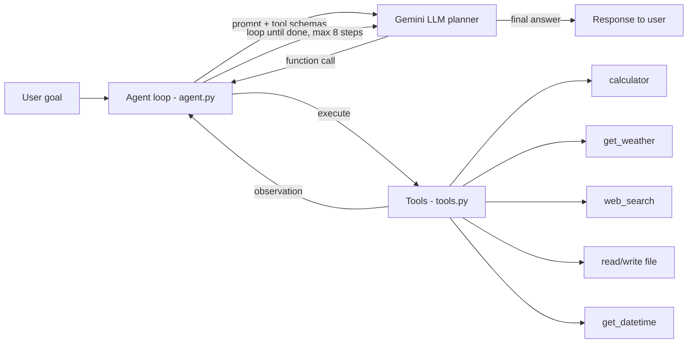

# Agentic AI Agent (DA-III)

An autonomous tool-calling agent built with Python and Google Gemini. Given a goal, it plans, picks tools, runs them, reads the results, and loops until the goal is done.

## Architecture / Schema



Tool definitions (name, params, description) are in [`tools_schema.json`](tools_schema.json).

## Features
- ReAct-style loop: reason, act (tool call), observe, repeat
- 6 tools: calculator (safe AST eval), live weather, web search, sandboxed file read/write, date/time
- Multi-turn memory (conversation history is kept)
- Step cap to prevent infinite loops

## Setup
```bash
git clone <your-repo-link>
cd ai-agent
pip install -r requirements.txt
cp .env.example .env   # add your Gemini key from aistudio.google.com
python agent.py
```

## Example
```
You: What's the weather in Chennai, and convert the temperature to Fahrenheit. Save it to weather.txt
  [step 1] 🔧 get_weather({'city': 'Chennai'})
  [step 2] 🔧 calculator({'expression': '31*9/5+32'})
  [step 3] 🔧 write_file({'filename': 'weather.txt', ...})
Agent: Done. It's 31°C (87.8°F) in Chennai, saved to weather.txt.
```

## Files
| File | Purpose |
|---|---|
| `agent.py` | Agent loop + Gemini calls |
| `tools.py` | Tool implementations + schemas |
| `tools_schema.json` | Tool definitions exported as JSON |
